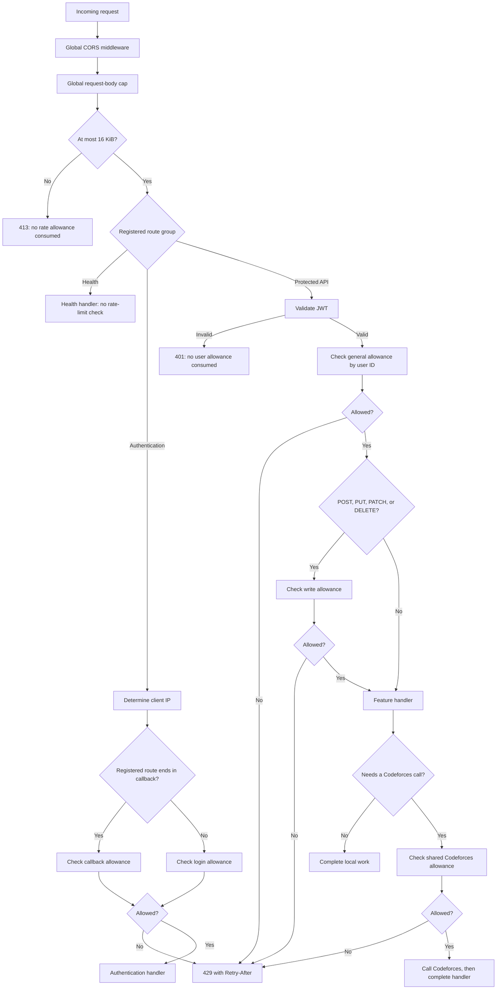

# Backend rate limiting

The backend uses one shared, in-memory rate-limit service per API process. Central route groups apply authentication and ordinary traffic limits. The user API checks the Codeforces allowance immediately before an external lookup or verification request.

This document describes the implemented behavior. Defaults are starting settings for this application, not universal standards.

## Contents

- [Policies and identities](#policies-and-identities)
- [Request flow and central registration](#request-flow)
- [Endpoint coverage](#endpoint-coverage)
- [Allowance calculation](#how-the-allowance-is-calculated)
- [Codeforces cooldown](#codeforces-cooldown)
- [Rejection contract](#rejection-contract)
- [Configuration and startup](#configuration-and-startup)
- [Client IPs and hosting proxies](#client-ips-and-hosting-proxies)
- [Memory, cleanup, and concurrency](#memory-cleanup-and-concurrency)
- [Operational boundaries](#operational-boundaries)
- [Code and verification map](#code-and-verification-map)

## Policies and identities

| Policy | Default refill rate | Maximum immediate burst | Identity | Scope |
| --- | --- | --- | --- | --- |
| General | 60 requests/minute | 10 | Verified JWT user ID | All registered protected user and list routes combined |
| Write | 30 requests/minute | 10 | Verified JWT user ID | POST, PUT, PATCH, and DELETE across the protected group |
| Login | 10 requests/minute | 10 | Client IP | Login routes and their aliases combined |
| Callback | 10 requests/minute | 10 | Client IP | Callback routes and their aliases combined |
| Codeforces | One attempt every 60 seconds | 1 | Verified JWT user ID | Verification and historical handle lookups combined |

The storage key is the pair `(policy, identity)`. General and write allowances for user 42 are separate entries. Another user has independent entries. Login and callback allowances for an IP are also separate.

Changing a JWT, Codeforces handle, route alias, or list ID does not reset the corresponding per-user allowance. People sharing a public IP share authentication allowances. These are per-identity limits, not a global ceiling on server or Codeforces traffic.

## Request flow



CORS may terminate a request before it reaches these groups, including preflight handling. Unknown paths are not protected by a catch-all application limiter; they retain normal routing behavior. IP limits for invalid JWTs, unknown paths, and broader abuse belong at the hosting proxy or another explicitly configured boundary.

### Central registration and `gin.IRouter`

[`internal/routes/routes.go`](internal/routes/routes.go) creates:

| Group | Middleware installed centrally | Registered features |
| --- | --- | --- |
| Public health | None of these rate-limit policies | Liveness and readiness |
| Authentication | `LimitAuthentication` | GitHub login and callback, including compatibility aliases |
| Protected `/api` | `Authenticate`, then `LimitUser` | Users and lists |

Feature registrars accept `gin.IRouter`, the routing interface implemented by both `*gin.Engine` and `*gin.RouterGroup`. This allows the central registrar to pass an existing group with its middleware already attached. The main server remains a `*gin.Engine`.

User routes add `/user` to the protected group; list routes add `/lists`. Feature files declare paths and handlers without installing authentication or rate limits themselves. Register future protected features on this same group to inherit the controls. A route added directly to the engine does not inherit middleware from a sibling group.

`LimitAuthentication` uses the registered route's final path component: `callback` selects the callback policy; other routes in its group select the login policy. This makes both current aliases share their allowance. A new authentication operation needing a distinct policy requires an explicit change to this classification.

## Endpoint coverage

| Method and path | Applied policies |
| --- | --- |
| `GET /auth/github/login`, `GET /api/auth/github/login` | Login by IP; aliases share a bucket |
| `GET /auth/github/callback`, `GET /api/auth/github/callback` | Callback by IP; aliases share a bucket |
| `GET /api/user/profile` | General |
| `PUT /api/user/cfhandle` | General + write; Codeforces only if a historical lookup is needed |
| `GET /api/user/cfverification-token` | General |
| `GET /api/user/verify-cftoken` | General; Codeforces if verification reaches the provider call |
| `GET /api/lists` | General |
| `POST /api/lists` | General + write |
| `GET /api/lists/:listId` | General |
| `PUT /api/lists/:listId` | General + write |
| `DELETE /api/lists/:listId` | General + write |
| `PUT /api/lists/:listId/item` | General + write |
| `DELETE /api/lists/:listId/item/:itemId` | General + write |
| `GET /health/live`, `GET /health/ready` | Exempt |

The verification endpoint uses GET today, so it consumes no write allowance. Its external work is still protected by the stricter Codeforces policy.

## How the allowance is calculated

The service uses Go's [`golang.org/x/time/rate`](https://pkg.go.dev/golang.org/x/time/rate) token bucket. A new entry starts full. Each accepted operation consumes one token; elapsed time replenishes tokens up to the burst capacity.

For ordinary traffic, refill rate is `configured requests per minute / 60` tokens per second. Defaults therefore replenish:

- General: one token every second, up to ten stored tokens.
- Write: one token every two seconds, up to ten stored tokens.
- Login and callback: one token every six seconds, up to ten stored tokens each.

“60 requests/minute” is a sustained refill rate. It is not a strict counter for each calendar minute or every rolling 60-second window. A full bucket permits an initial burst in addition to tokens replenished over time. Idle time beyond a full bucket does not accumulate additional capacity.

If ten general requests arrive together, all ten can proceed. An eleventh at that same instant receives `429` with a one-second retry delay. After one second, one request can proceed, assuming no other request consumed that token.

### Multiple policies on one request

Checks run sequentially: general, then write when applicable, then Codeforces if the handler needs it. They do not form one transaction across policies.

A write request that passes general but fails write has already consumed its general token. A request rejected by the Codeforces cooldown has already consumed its applicable route allowances. These earlier allowances are not refunded.

Handler validation and downstream database/provider failures also do not refund allowances already accepted. This bounds repeated invalid or failing work after it reaches the relevant check.

## Codeforces cooldown

The Codeforces bucket has capacity one and replenishes over `CODEFORCES_COOLDOWN`, defaulting to 60 seconds. The allowance is consumed when the attempt starts, not when it finishes. It is a frequency limit, not an in-flight concurrency lock.

Both qualifying operations use the same user identity and policy:

1. Verification reads the selected user state and rejects already-verified users before checking the allowance. It checks the allowance immediately before `GetVerificationValue`.
2. Handle selection checks the allowance immediately before `GetCurrentHandle` when a nonempty previously verified handle differs from the requested handle, ignoring case.

Challenge generation, invalid input, failed user reads, and handle changes requiring no provider request do not consume the Codeforces allowance. They can still consume general/write allowances.

Provider failures, a mismatching verification token, stale verification conflicts, and database failures after a provider call consume the Codeforces allowance. Changing accounts does not create a fresh allowance.

```mermaid
sequenceDiagram
    participant Client
    participant API as User API
    participant Limiter as Shared limiter
    participant CF as Codeforces
    Note over Client,CF: General/write checks have already passed
    Client->>API: Verify ownership at t=0
    API->>Limiter: Allow Codeforces for user 42
    Limiter-->>API: Allowed; consume token
    API->>CF: Get verification value
    CF-->>API: Success or failure
    API-->>Client: Operation response
    Client->>API: Handle change needing lookup at t=20s
    API->>Limiter: Allow Codeforces for user 42
    Limiter-->>API: Rejected; retry in 40s
    API-->>Client: 429, Retry-After: 40
    Note over API,CF: No Codeforces request on rejection
    Client->>API: Retry qualifying operation at t=60s
    API->>Limiter: Allow Codeforces for user 42
    Limiter-->>API: Allowed
    API->>CF: Provider request
```

Repeated rejected attempts do not extend the refill deadline. They update the entry's last-access timestamp for cleanup purposes. Simultaneous attempts are checked under a mutex, so only one can consume an available token.

## Rejection contract

All policies use the same response helper:

```http
HTTP/1.1 429 Too Many Requests
Retry-After: 40
Cache-Control: no-store
Content-Type: application/json; charset=utf-8

{"error":"Too many requests. Try again later."}
```

`Retry-After` is the calculated delay rounded up to whole seconds, with a minimum of one. Middleware aborts the request; it does not queue or sleep. A handler-level Codeforces rejection stops before its provider call, although earlier user reads may already have run.

CORS exposes `Retry-After` to allowed browser origins. Clients should wait that long before retrying and avoid immediate retry loops. The header describes the rejecting policy; it is not a reservation or a guarantee that every policy will allow a future request. Another concurrent request may use the available allowance first.

When the storage cap prevents creation of a new entry, the response uses a 60-second retry hint. Capacity may still be exhausted after that interval.

## Configuration and startup

```env
API_RATE_PER_MINUTE=60
WRITE_RATE_PER_MINUTE=30
AUTH_RATE_PER_MINUTE=10
CODEFORCES_COOLDOWN=1m
# Example only: replace with the actual proxy addresses for your deployment.
TRUSTED_PROXIES=127.0.0.1,10.0.0.0/8
```

| Setting | Default | Validation and effect |
| --- | --- | --- |
| `API_RATE_PER_MINUTE` | `60` | Positive integer; general refill rate |
| `WRITE_RATE_PER_MINUTE` | `30` | Positive integer; write refill rate |
| `AUTH_RATE_PER_MINUTE` | `10` | Positive integer; used separately for login and callback |
| `CODEFORCES_COOLDOWN` | `1m` | Positive Go duration; time to replenish one Codeforces allowance |
| `TRUSTED_PROXIES` | Empty; no trusted proxies | Comma-separated IP addresses or CIDRs, validated by Gin during startup |

Empty rate settings use defaults. Existing process environment takes precedence over `.env`. Invalid settings stop startup. The `envKey` argument in the positive-integer parser identifies the setting in errors, for example `API_RATE_PER_MINUTE must be a positive integer`; it does not identify a rate-limit bucket.

Bursts of ten, the one-token Codeforces capacity, the ten-minute idle lifetime, the one-minute cleanup interval, and the production 10,000-entry cap are code settings rather than environment variables. `ratelimit.Config.MaxEntries` can be supplied by a constructor caller; the API entry point uses its default.

Startup in [`cmd/api/main.go`](cmd/api/main.go) loads the settings, constructs one `ratelimit.Service`, passes it to route dependencies, and injects the same instance into `users.NewAPI` through `WithRateLimits`. There is no live configuration reload; changing environment settings requires restarting the process.

The constructor and route dependency injection permit a nil limiter for isolated callers/tests. Production startup supplies it to both boundaries. Omitting `Dependencies.RateLimits` disables route limits; omitting `users.WithRateLimits` disables the operation-level Codeforces limit. Preserve both injections when adding another application entry point.

## Client IPs and hosting proxies

Authentication identities come from Gin's `Context.ClientIP()`. With no trusted proxies, Gin uses the direct peer address and ignores forwarded client addresses from untrusted peers.

When a hosting proxy forwards all requests, configure its actual IP addresses or CIDRs in `TRUSTED_PROXIES`. Otherwise all clients behind it share the proxy's allowance. The proxy must sanitize forwarded client-IP headers, and the trusted range must be limited to infrastructure you control.

Per-user limits use the verified JWT user ID, so authenticated users sharing an IP keep separate general/write/Codeforces allowances. Authentication IP limits still apply before a session exists.

See Gin's [trusted-proxy guidance](https://gin-gonic.com/en/docs/middleware/security-guide/) for deployment configuration. The repository configures the application; it does not provision a hosting proxy or its rate-limit rules.

## Memory, cleanup, and concurrency

The service stores one struct per `(policy, identity)`, containing its token bucket and `lastSeen` timestamp. All lookup, creation, cleanup, and allowance calculations run under one service mutex. Provider and database calls run after the mutex is released.

The global cap is 10,000 entries, not 10,000 users. A user can occupy general, write, and Codeforces entries; an IP can occupy login and callback entries. At capacity, new keys are rejected. Existing entries continue to use their own allowances. Active entries are not evicted to make room, which would reset their protection.

Cleanup is lazy: the first allowance check, and subsequent checks at least one minute after the last sweep, scan for idle entries. There is no background cleanup goroutine. If no requests arrive, idle entries remain allocated within the cap until traffic resumes or the process exits.

An entry expires after no access for `max(10 minutes, CODEFORCES_COOLDOWN)`. Both accepted and rejected checks of an existing entry update `lastSeen`. Using the longer lifetime preserves configured cooldowns longer than ten minutes. Removing an idle entry allows its next use to start with a full bucket.

The service reserves a token to calculate an exact retry delay. A delayed reservation is immediately canceled, so rejection neither consumes future capacity nor schedules a request.

## Operational boundaries

| Situation | Current behavior |
| --- | --- |
| Process restart or redeployment | All allowances reset; PostgreSQL is not involved |
| Multiple API instances | Each has independent allowances; a client reaching different instances can exceed the intended combined rate |
| Multiple users contacting Codeforces | Each has an independent allowance; no global provider budget is enforced |
| Missing/invalid JWT, unknown path, CORS preflight | No protected user allowance is consumed |
| Exhausted limiter storage | New identity/policy entries receive `429`; existing entries remain usable subject to their limits |
| Slow request or large body | Rate limiting does not set body-size or HTTP read-time limits |
| Large stored dataset or response | Rate limiting does not enforce account quotas or pagination |
| Health probes | Exempt from application rate limits; readiness retains its separate bounded database check |

For multiple instances, move allowances to shared enforcement such as a shared store or hosting proxy. A proxy can also apply broader IP/connection protections before requests reach the Go process. Application rate limits complement request-size validation, storage quotas, database deadlines, and provider timeouts. The implemented body cap and write-time name/storage bounds are described in [USAGE_LIMITS.md](USAGE_LIMITS.md).

## Code and verification map

| File or suite | Responsibility |
| --- | --- |
| [`internal/ratelimit/limiter.go`](internal/ratelimit/limiter.go) | Policy keys, token buckets, retry delay, synchronization, capacity, cleanup, rejection response |
| [`internal/middlewares/rate_limit.go`](internal/middlewares/rate_limit.go) | Per-user general/write checks and authentication IP policy selection |
| [`internal/routes/routes.go`](internal/routes/routes.go) | Shared middleware registration and group boundaries |
| [`internal/users/users_handler.go`](internal/users/users_handler.go) | Conditional operation-level Codeforces checks |
| [`configs/configs.go`](configs/configs.go) | Environment parsing and validation |
| [`cmd/api/main.go`](cmd/api/main.go) | Shared instance construction, proxy trust, and CORS response-header exposure |
| [`tests/unit/ratelimit/limiter_test.go`](tests/unit/ratelimit/limiter_test.go) | Refills, identity isolation, concurrent attempts, capacity, expiration, configuration, retry response |
| [`tests/unit/middlewares/rate_limit_test.go`](tests/unit/middlewares/rate_limit_test.go) | Combined read/write budgets and spoofed forwarded IPs |
| [`tests/unit/routes/rate_limit_test.go`](tests/unit/routes/rate_limit_test.go) | Actual route coverage, shared aliases, separate auth budgets, authentication order, exempt health probes |
| [`tests/unit/users/users_handler_test.go`](tests/unit/users/users_handler_test.go) | Shared Codeforces cooldown, failed attempts, and local-only changes |
| [`tests/unit/configs/configs_test.go`](tests/unit/configs/configs_test.go) | Defaults, overrides, malformed/zero rates, cooldown parsing, and proxy-list parsing |

From the `backend` directory, run the complete unit suite with race detection:

```sh
go test -race ./tests/unit/...
```

The limiter supports an injected clock so refill and expiration tests do not wait for real minutes. The concurrent-attempt test verifies that only one same-user Codeforces attempt proceeds. Tests use mocks and do not need a running API, PostgreSQL, or real Codeforces requests. Follow [TESTING.md](TESTING.md) for broader backend validation.
